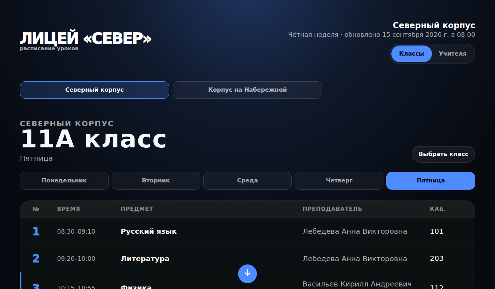
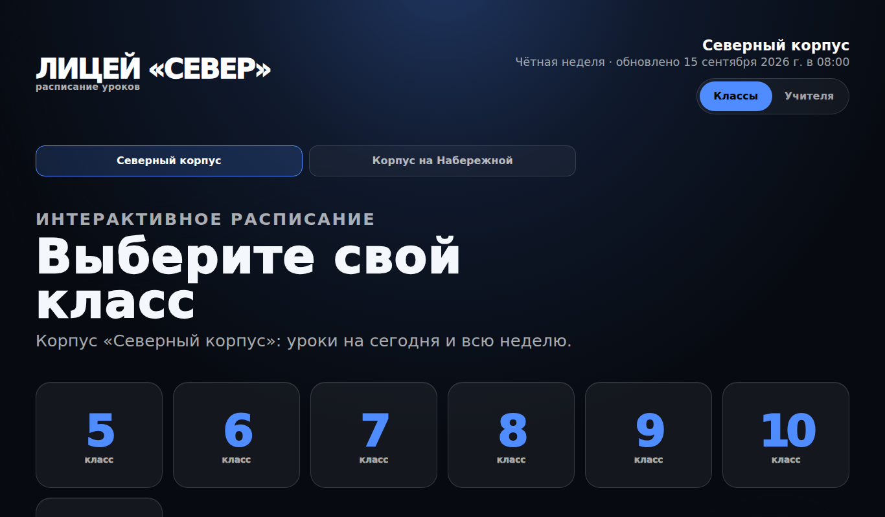
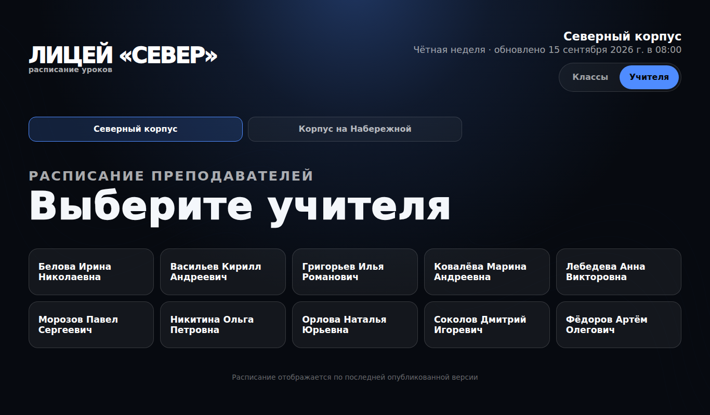
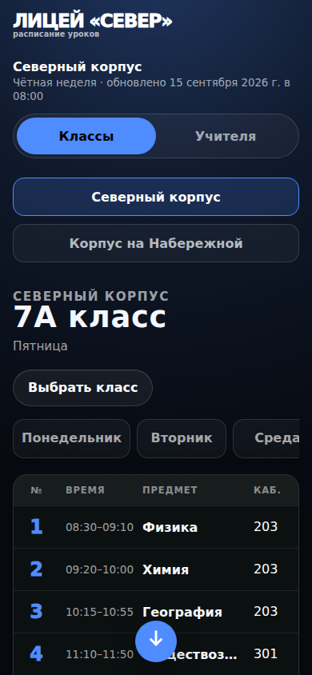

<div align="center">

# Timetable Kiosk

**Интерактивное расписание уроков для сенсорного терминала в холле**

Статический сайт без сборки и зависимостей. Работает офлайн и открывается на любом экране: от киоска 1920×1080 до телефона.


**[Открыть демо →](https://hoonkero.github.io/timetable-kiosk/)**



</div>

## Что умеет

- **Классы и учителя.** Ученик выбирает параллель, потом подгруппу и видит уроки на день. Учитель находит себя в списке и видит свои уроки по всем классам.
- **Чётные и нечётные недели.** Неделя определяется по ISO-номеру, лишние уроки скрываются.
- **Замены.** Если у урока задан `actualTeacher`, строка подсвечивается с пометкой «вместо …».
- **Офлайн.** Последнее удачно загруженное расписание сохраняется в IndexedDB. Если сеть пропала, терминал показывает его с бейджем «Сохранённая версия».
- **Живые данные.** Опрос раз в минуту, экран перерисовывается только при смене ревизии, поэтому ничего не мигает.
- **Ссылки.** Корпус, класс и день записаны в URL, их можно добавить в закладки или сделать QR-кодом на двери кабинета.
- **Доступность.** Крупные сенсорные цели, `aria-live`, `prefers-reduced-motion`.

| Старт | Учителя | Телефон |
|---|---|---|
|  |  |  |

## Запуск

```bash
git clone https://github.com/Hoonkero/timetable-kiosk
cd timetable-kiosk
python -m http.server 8080      # или любой статический сервер
# http://localhost:8080/?campusId=north
```

Для киоска: Chromium в режиме `--kiosk --noerrdialogs --disable-pinch` и нужный `?campusId=` в URL.

## Настройка

Всё настраивается в [`config.js`](config.js): название, корпуса и откуда брать данные.
Данные лежат статическими JSON в `data/` ([формат](data/README.md)) или приходят с вашего API
через `campusesUrl` и `scheduleUrl`.

```js
window.KIOSK_CONFIG = {
  title: "ЛИЦЕЙ «СЕВЕР»",
  campuses: [{ id: "north", name: "Северный корпус", dataUrl: "data/north.json" }]
};
```

Перед публикацией данные стоит проверить: `node scripts/validate-data.js data/*.json`.

## Откуда проект

Терминал был частью внутреннего портала, где расписание из aSc Timetables конвертировалось на сервере
и публиковалось на экраны в холлах. Для этого репозитория я отвязал его от бэкенда и авторизации,
вынес настройки в `config.js`, перерисовал оформление и сделал демо-данные (все имена вымышленные).

## Лицензия

MIT © [Hoonkero](https://github.com/Hoonkero)
